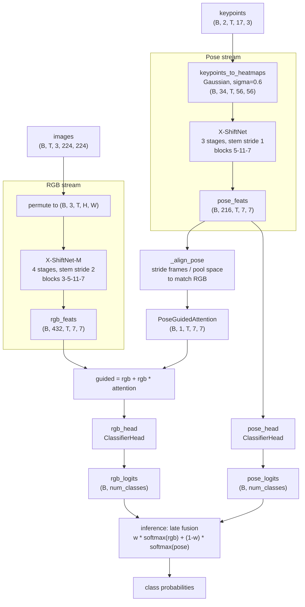
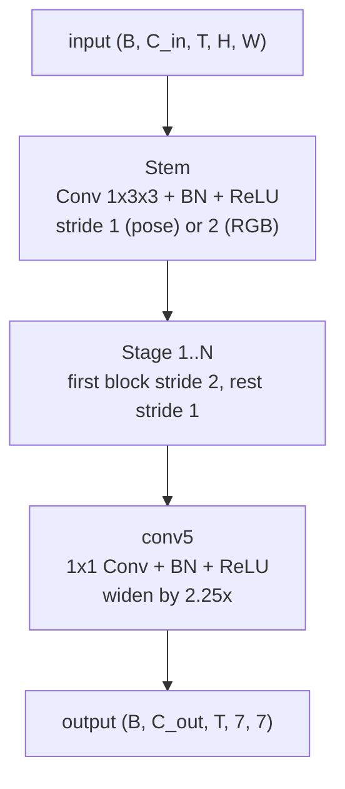
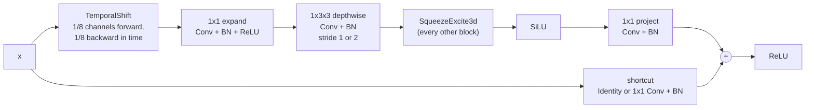
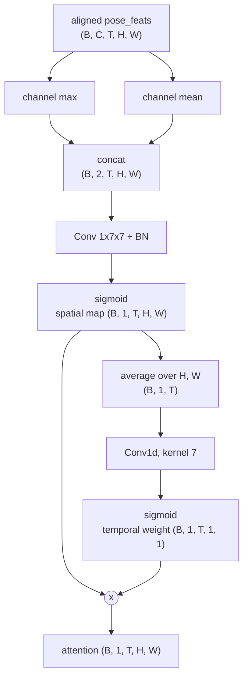
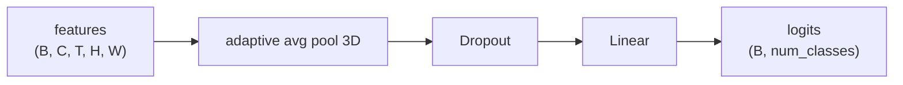

# EPAM-Net Architecture

Pose-driven, attention-guided two-stream network for punch recognition, implemented in `src/boxing/model.py`.

**Inputs**

| Name | Shape | Notes |
|---|---|---|
| `images` | `(B, T, 3, H, W)` | normalised RGB frames, e.g. T=16, 224x224 |
| `keypoints` | `(B, 2, T, 17, 3)` | `(x, y, score)`, x/y in [0, 1] of the crop; 2 boxers, 17 joints |

**Outputs**: `EPAMOutput(rgb_logits, pose_logits)`, each `(B, num_classes)`. At inference the two softmax scores are fused with `rgb_weight`.

## Overview

## X-ShiftNet backbone

Used for both streams with different depth, width and stem stride. All convolutions are 2D (`1x3x3` kernels inside `Conv3d`), and temporal mixing comes from the parameter-free Temporal Shift Module. The frame count is never reduced.

| Stream | Input channels | Stem stride | Stage blocks | Stage channels | Output channels |
|---|---|---|---|---|---|
| RGB | 3 | 2 | 3, 5, 11, 7 | 24, 48, 96, 192 | 432 |
| Pose | 34 | 1 | 5, 11, 7 | 24, 48, 96 | 216 |

### ShiftBlock

Inverted residual block. The shift sits on the residual branch only, so the shortcut keeps the original frames. Squeeze-and-excitation is used on every other block (`(i + 1) % 2 == 0`).

## Pose-guided attention

Computed from the pose features and used to re-weight the RGB features. The output lies in [0, 1].

## Classifier head

Each stream has its own head: `Dropout(0.5)`, global average pool over (T, H, W), and one `Linear` layer to `num_classes`.

