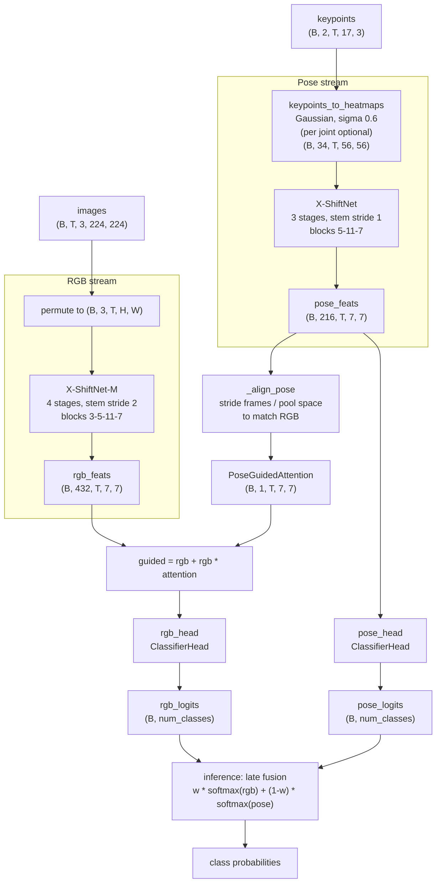
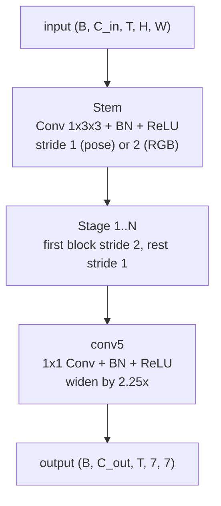
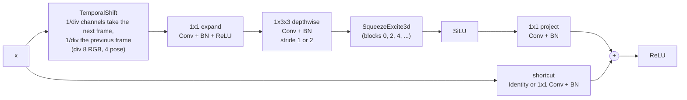
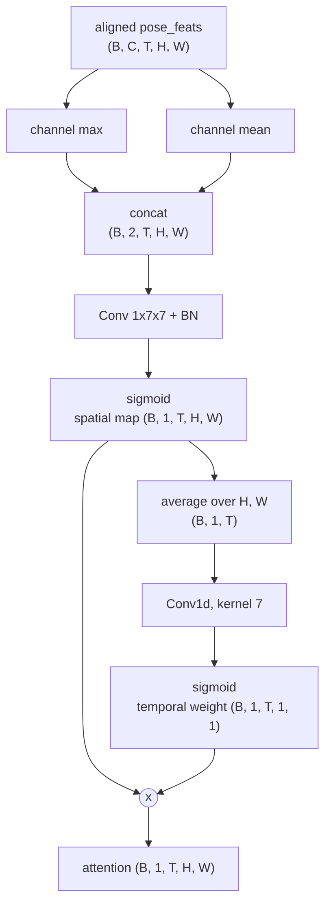
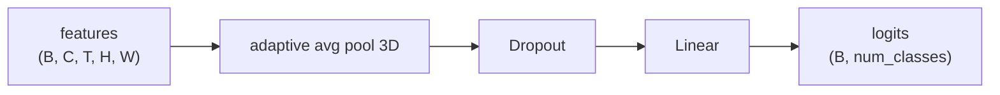

# EPAM-Net Architecture

Pose-driven, attention-guided two-stream network for punch recognition, implemented in `src/boxing/model.py`.

**Inputs**

| Name | Shape | Notes |
|---|---|---|
| `images` | `(B, T, 3, H, W)` | normalised RGB frames, e.g. T=16, 224x224 |
| `keypoints` | `(B, 2, T, 17, 3)` | `(x, y, score)`, x/y in [0, 1] of the crop; 2 boxers, 17 joints |

**Outputs**: `EPAMOutput(rgb_logits, pose_logits)`, each `(B, num_classes)`. At inference the two softmax scores are fused with `rgb_weight`.

## Overview

## Pose heatmaps

`keypoints_to_heatmaps` renders each joint as a Gaussian at its `(x, y)` position on a 56x56 grid, scaled by its confidence. Joints with a score at or below `min_score` (0.1) give an empty map. The channels are ordered boxer 0's 17 joints, then boxer 1's.

`sigma` (the Gaussian radius, in heatmap pixels) is either one value for every joint (default 0.6) or a list of 17, one per COCO joint, so each keypoint can have its own radius. A list must have 17 positive values. Set it with `EPAMNetConfig(sigma=...)` or `--sigma` on the training script.

## X-ShiftNet backbone

Used for both streams with different depth, width and stem stride. All convolutions are 2D (`1x3x3` kernels inside `Conv3d`), and temporal mixing comes from the parameter-free Temporal Shift Module. The frame count is never reduced.

| Stream | Input channels | Stem stride | Stage blocks | Stage channels | Output channels |
|---|---|---|---|---|---|
| RGB | 3 | 2 | 3, 5, 11, 7 | 24, 48, 96, 192 | 432 |
| Pose | 34 | 1 | 5, 11, 7 | 24, 48, 96 | 216 |

### ShiftBlock

Inverted residual block. The shift sits on the residual branch only, so the shortcut keeps the original frames. Squeeze-and-excitation is used on every other block, starting with the first (`i % 2 == 0`, i.e. blocks 0, 2, 4, ...), and its hidden width is the block's inner width divided by 16, rounded to a multiple of 8 with a minimum of 8 (54 gives 8, 216 gives 16). The shift, SE placement and SE width follow the official EPAM-Net code, so its pretrained weights fit.

## Pose-guided attention

Computed from the pose features and used to re-weight the RGB features. The output lies in [0, 1].

## Classifier head

Each stream has its own head: `Dropout(0.5)`, global average pool over (T, H, W), and one `Linear` layer to `num_classes`.

## Temporal shift

`TemporalShift` moves the first `C // div` channels to the next frame (`out[t] = x[t + 1]`) and the next `C // div` channels to the previous frame (`out[t] = x[t - 1]`). Frames shifted past either end are zero-filled, and the rest of the channels are untouched. It has no parameters. The divisor is `rgb_shift_div` (8) for the RGB stream and `pose_shift_div` (4) for the pose stream, the values the official code uses.

## Pretrained backbones

`boxing.pretrained.load_official_backbone` loads the official EPAM-Net backbones (mmaction checkpoints, e.g. NTU RGB+D 120) into `rgb_backbone` or `pose_backbone`. It renames the keys (`layerN.i.conv1` to `stages.N-1.i.expand`, and so on) and loads strictly, so any shape or key mismatch raises. The heads and the attention block are not loaded. The official pose stem has 17 input channels (one person), so it is copied for both boxers and divided by 2. On the training script, use `--init-rgb` and `--init-pose`.

Checkpoints saved before the layout above (SE on odd blocks, a single shift fold of 8, the opposite shift direction) do not load into the current model.
