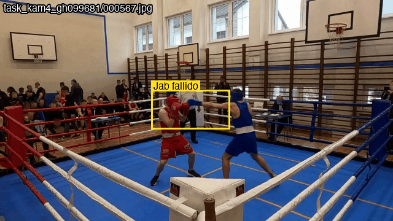
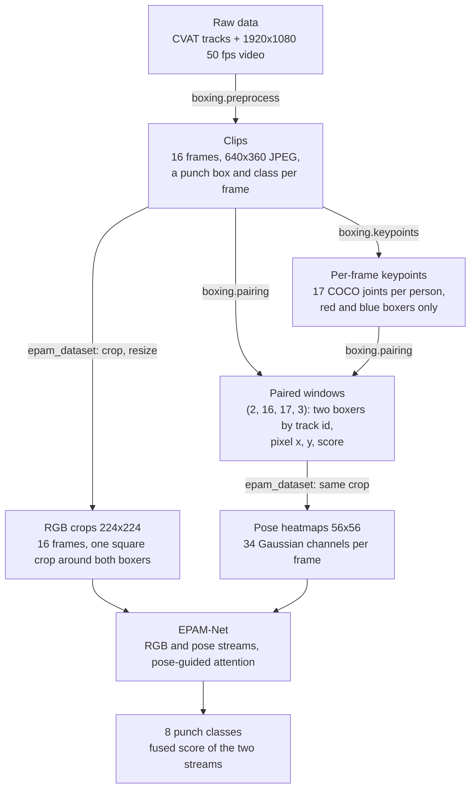
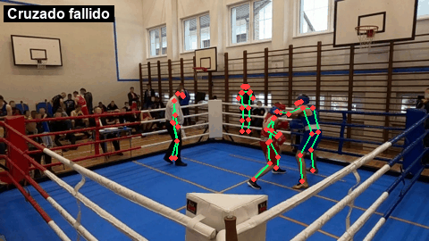
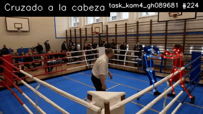
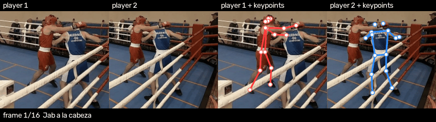

# Boxing punch detection

<p align="center"></p>

*Training clip from `task_kam4_gh099681`: the yellow box marks a "Jab fallido" (left-hand miss).*

## Pipeline

The raw CVAT annotations and videos go through five transformations before a punch is classified. Each stage writes its output to disk, so any one can be rerun on its own.



| stage               | command                         | input                   | output                                                                                                |
| ------------------- | ------------------------------- | ----------------------- | ----------------------------------------------------------------------------------------------------- |
| 1. Clips            | `boxing.preprocess`             | CVAT tracks, MP4 videos | `data/processed/punch-seq/`: 16-frame clips with a box and class per frame                            |
| 2. Keypoints        | `boxing.keypoints`              | the clips' frames       | `data/processed/punch-keypoints-boxers/`: one JSON per frame                                          |
| 3. Pairing          | `boxing.pairing`                | clips + keypoints       | `data/processed/punch-pairs/`: `X` of shape `(N, 2, 16, 17, 3)`                                       |
| 4. Crop and augment | `boxing.epam_dataset`           | clips and keypoints     | 224×224 RGB frames and keypoints in the same crop; crop, mirror and brightness jitter during training |
| 5. Classify         | `boxing.train_punch_classifier` | crops and keypoints     | logits from each stream, fused for the prediction, plus the best checkpoint                           |

Steps 4 and 5 run inside one training command. The full sequence:

```bash
uv run python -m boxing.preprocess data/raw/punch data/processed/punch-seq
uv run python -m boxing.keypoints data/processed/punch-seq data/processed/punch-keypoints-boxers
uv run python -m boxing.pairing --src data/processed/punch-seq \
    --keypoints data/processed/punch-keypoints-boxers/images --dst data/processed/punch-pairs
uv run python -m boxing.train_punch_classifier --test   # check the pipeline in under a minute
uv run python -m boxing.train_punch_classifier          # full training run
```

### Example: one clip through the first stages

**Stage 1, the clip.** The animation at the top of this page is one clip: 16 frames with the hand-drawn punch box (yellow). The label is the class of the punch in that box.

**Stage 2, keypoints.** The pose model finds 17 joints on every person in the frame, including the referee and the audience:

<p align="center"></p>

*Skeletons on every detected person. The label is the clip's class (here "Cruzado fallido").*

**Stage 2 with the boxer filter.** The role classifier drops the referee and everyone else, keeping the red and blue boxers. Those two skeletons are what `boxing.pairing` turns into the two boxers of each window:

<p align="center"></p>

*Only the two boxers are kept (here "Cruzado al cuerpo").*

**The model's input.** The same windows reach EPAM-Net as one crop per boxer, with and without keypoints. One sample per class is shown here:

<p align="center"></p>

*Eight samples, one per class (seed 42). Each frame shows player 1 and player 2 as plain crops, then with their keypoints.*

## Dataset: Olympic Boxing Punch Classification Video Dataset

Raw data lives in `data/raw/punch/`. Each of the 29 folders is one recording session:

```
data/raw/punch/
└── task_kam{2|4}_gh{NNNNNN}/
    ├── annotations.json      # CVAT export (video 1.1 JSON)
    └── data/GH{NNNNNN}.mp4   # source video
```

- `kam2` and `kam4` are the two camera positions. There are 17 `kam2` tasks and 12 `kam4` tasks.
- Videos are 1920×1080, 50 fps, about 3,186 frames (~64 s) per file.

### Annotation format

Each `annotations.json` is a single-element JSON list. The element has four keys:

| key       | contents                               |
| --------- | -------------------------------------- |
| `version` | CVAT export version (18 in the sample) |
| `tags`    | always empty                           |
| `shapes`  | always empty (no frame-level shapes)   |
| `tracks`  | list of punch events, one per track    |

Each **track** is one punch event:

```json
{
  "frame": 653,            // first frame of the track
  "group": 0,
  "source": "manual",
  "label": "Chybienie lewą ręką",
  "attributes": [],
  "shapes": [
    {
      "type": "rectangle",
      "points": [x1, y1, x2, y2],   // pixel coordinates, top-left and bottom-right
      "frame": 653,
      "occluded": false,
      "outside": false,              // true = the box disappears on this frame
      "z_order": 0,
      "attributes": []
    }
  ]
}
```

- Shapes are **keyframes**, not one per frame. In the sample, a track spans about 5 keyframes. Interpolate between them to get the box on any frame.
- `outside: true` marks the last frame of the track.
- Boxes are axis-aligned rectangles around the **boxer's** fist/head/body, drawn by hand (`source: "manual"`). No track has attributes.

### Labels

The raw labels are in Polish. There are 8 classes: a target or outcome (head, body, block, miss) combined with a hand (left or right). `preprocess.py` translates each one to a Spanish boxing term and assigns a fixed class id:

|   id | raw label (Polish)     | English           | processed name (Spanish) | count |
| ---: | ---------------------- | ----------------- | ------------------------ | ----: |
|    0 | `Głowa lewą ręką`      | head, left hand   | `Jab a la cabeza`        | 1,683 |
|    1 | `Głowa prawą ręką`     | head, right hand  | `Cruzado a la cabeza`    |   833 |
|    2 | `Chybienie lewą ręką`  | miss, left hand   | `Jab fallido`            |   734 |
|    3 | `Chybienie prawą ręką` | miss, right hand  | `Cruzado fallido`        |   449 |
|    4 | `Blok lewą ręką`       | block, left hand  | `Bloqueo de jab`         |   360 |
|    5 | `Blok prawą ręką`      | block, right hand | `Bloqueo de cruzado`     |   178 |
|    6 | `Korpus lewą ręką`     | body, left hand   | `Jab al cuerpo`          |   193 |
|    7 | `Korpus prawą ręką`    | body, right hand  | `Cruzado al cuerpo`      |   179 |

Counts are across all 29 files. The total is 4,609 tracks and 22,274 keyframe boxes.

**The jab/cross names are an assumption.** The annotations record the hand and the target, not the punch type. Left hand is mapped to *jab* and right hand to *cross* (`cruzado`), which holds for an orthodox (right-handed) boxer. If a boxer is southpaw the mapping is reversed, and hooks and uppercuts cannot be told apart in this data. The class ids come from the order of `RAW_LABELS` in `src/boxing/preprocess.py`, and the Spanish names from `LABELS` in the same file.

Notes:
- Left/right are encoded in the label. Use the label, not the box position, to decide the hand.
- The classes are imbalanced. Head punches are the largest group. Body punches are the smallest.
- Each label combines a **target** (head, body, or block/miss) with a **hand** (left or right). If the task is "which punch was thrown", you may want to merge the hand or the target.

### Dataset stats

- 29 tasks, 4,609 tracks, 22,274 keyframe boxes.
- Tracks per file vary a lot (50 to 162 in the samples checked).
- Only the `rectangle` shape type is used.

## Processed dataset

`src/boxing/preprocess.py` turns the raw CVAT data into **clips**: every training example is a sequence of 16 consecutive frames with a detection target (boxes and a class per box) on every frame.

```
uv run python -m boxing.preprocess data/raw/punch data/processed/punch-seq
uv run python -m boxing.preprocess data/raw/punch data/processed/punch-seq-test --test   # quick check
```

| option           | default | meaning                                              |
| ---------------- | ------: | ---------------------------------------------------- |
| `--max-size`     |     640 | resize so the longest image side is this many pixels |
| `--val-fraction` |     0.2 | fraction of tasks held out for validation            |
| `--seed`         |       0 | seed for the train/val split                         |
| `--seq-len`      |      16 | frames per clip (also written to `labels.json`)      |
| `--test`         |     off | small end-to-end run: 3 tasks, first 5 clips of each |

The clip length is `SEQ_LEN = 16` in `preprocess.py` (0.32 s at 50 fps). Punch tracks last 4 frames at the median, 12 at the 99th percentile and 19 at most, so 16 frames hold almost every punch plus context on both sides.

### Output layout

```
data/processed/punch-seq/
├── labels.json                 # class names, ids, and seq_len
├── train.jsonl                 # one JSON record per clip
├── val.jsonl
└── images/
    └── task_kam2_gh078416/
        └── 000653.jpg          # frame number, zero-padded to 6 digits
```

Clips that overlap in time share the same JPEG files.

### What the script does

1. **Interpolate.** For each track, boxes are linearly interpolated between keyframes, so every frame from the first keyframe up to (not including) the `outside: true` keyframe gets a box.
2. **Cut clips.** Each track becomes one clip of 16 frames centred on the track: the start is `(first + last) // 2 - 8`, shifted to stay inside the video. A track longer than 16 frames keeps its centre 16 frames. Tracks annotated past the end of the video are dropped and counted in the summary line.
3. **Label every frame.** Each frame of a clip lists the boxes of **all** punches visible on it, not only the clip's own track, so overlapping punches stay labelled. Context frames with no punch get empty lists.
4. **Extract frames.** Only frames inside some clip are decoded from the MP4 and saved as JPEG (quality 95).
5. **Resize.** Images are scaled so the longest side is `--max-size` (never upscaled). 1920×1080 becomes 640×360.
6. **Normalise boxes.** Pixel `(x1, y1, x2, y2)` becomes `(cx, cy, w, h)` in `[0, 1]`, relative to the source image size. Boxes are clipped to the image, and degenerate boxes are dropped. Because the values are relative, the resize does not change them.
7. **Map labels.** Each raw Polish label becomes the class id from the table above. An unknown label raises an error.
8. **Split by task.** Whole recording sessions go to either train or val, never both, so clips from one video cannot leak across splits. The split is seeded and reproducible.

### `train.jsonl` / `val.jsonl`

One JSON object per line, one line per clip (`frames` shortened here; it always has 16 entries):

```json
{
  "task": "task_kam2_gh078416",
  "track": 0,
  "label": 2,
  "start": 647,
  "width": 640,
  "height": 360,
  "frames": [
    {"image": "images/task_kam2_gh078416/000647.jpg", "class_labels": [], "boxes": []},
    {"image": "images/task_kam2_gh078416/000653.jpg", "class_labels": [2], "boxes": [[0.49, 0.50, 0.20, 0.18]]}
  ]
}
```

| field                   | meaning                                                                        |
| ----------------------- | ------------------------------------------------------------------------------ |
| `task`                  | recording session the clip comes from                                          |
| `track`                 | index of the clip's punch in that task's `annotations.json` `tracks` list      |
| `label`                 | class id of that punch (metadata; training uses the per-frame targets)         |
| `start`                 | frame number of the first frame                                                |
| `width`/`height`        | size of the saved JPEGs in pixels                                              |
| `frames`                | the 16 frames in order, each with `image`, `class_labels` and `boxes`          |
| `frames[].image`        | path relative to the processed dataset folder                                  |
| `frames[].class_labels` | class id for each box on that frame (see the label table)                      |
| `frames[].boxes`        | `[cx, cy, w, h]` per box, normalised to `[0, 1]`; same order as `class_labels` |

### `labels.json`

```json
{
  "names": ["Jab a la cabeza", "Cruzado a la cabeza", "..."],
  "id2label": {"0": "Jab a la cabeza", "1": "Cruzado a la cabeza", "...": "..."},
  "label2id": {"Jab a la cabeza": 0, "Cruzado a la cabeza": 1, "...": "..."},
  "seq_len": 16
}
```

`id2label` keys are strings because JSON requires it. The keypoint pipeline reads `names` from this file.


## Pose keypoints

`boxing.keypoints` runs a COCO pose model over each frame of the processed clips and saves one JSON per frame, mirroring the image paths:

```bash
uv run python -m boxing.keypoints data/processed/punch-seq data/processed/punch-keypoints-boxers
```

By default it keeps only the red and blue boxers, using the trained role model (`data/processed/role-classifier/role_model.pt`). Pass `--all-people` to keep everyone, or `--color-rules` to use the torso-colour heuristics. Each person has a pixel box, a score, and 17 COCO keypoints. Weights come from the Hugging Face Hub on first use. The model is licensed for non-commercial use only.

## Paired windows

`boxing.pairing` joins each clip with the keypoints of the boxers in it. Each person in every frame is tracked with DeepSORT, using a Kalman motion model and a Re-ID appearance embedding, so the track id survives clinches where two boxers overlap. For each clip the two tracks seen in the most frames are the boxers, and they are ordered by track id. No role is assigned: the labeled punch box is not used. Row 0 is the boxer with the lower track id, which is not the same person from one window to the next. If a track is not matched on a frame, the nearest unmatched person to its last position fills in.

```bash
uv run python -m boxing.pairing \
    --src data/processed/punch-seq \
    --keypoints data/processed/punch-keypoints-boxers/images \
    --dst data/processed/punch-pairs
```

Output in `--dst`:

- `train.npz` and `val.npz`: `X` with shape `(N, 2, 16, 17, 3)` (row 0 the first boxer, row 1 the second, ordered by track id; last axis `x, y, score` in pixels) and `y` with the class id. Missing people are zero-filled with score 0.
- `train.jsonl` and `val.jsonl`: one metadata row per window, aligned with `X`. Each row has `track_ids` (the two DeepSORT ids in row order), `track_frames` (frames each row was filled), `method` (counts of `track`, `nearest` and `missing` frames) and a `quality` field: `good` (both boxers present on every frame), `partial` (some frames missing a boxer), or `no_boxers`.
- `labels.json`: copied from `--src`.

Windows from the same fight never appear in both splits. The `good`/`partial` split is a warning, not a filter: most `partial` windows are missing a boxer on a few frames only.

## Train EPAM-Net

`boxing.train_punch_classifier` trains EPAM-Net (`src/boxing/model.py`) on the clips from `boxing.preprocess` and the keypoints from `boxing.pairing`. It needs both the `punch-seq` folder (for the frames) and the `punch-pairs` folder (for the keypoints and labels).

### Test mode first

Before a long run, check the whole pipeline on a few windows:

```bash
uv run python -m boxing.train_punch_classifier --test
```

Test mode uses 24 training and 16 validation windows, 2 epochs, and the folder `runs/epam-test/`. It runs data loading with augmentation, the forward and backward passes, the learning-rate schedule, validation, saving the checkpoint, reloading it (it fails if the reloaded checkpoint scores differently), and writing `metrics.json`. The numbers it prints are meaningless. Use it after any change to the data, the model or the training loop.

### Full run

```bash
uv run python -m boxing.train_punch_classifier
uv run python -m boxing.train_punch_classifier --epochs 40 --batch-size 8 --lr 0.01 --out runs/epam-run2
```

| option              |                      default | meaning                                                                                                             |
| ------------------- | ---------------------------: | ------------------------------------------------------------------------------------------------------------------- |
| `--pairs`           | `data/processed/punch-pairs` | output of `boxing.pairing`                                                                                          |
| `--src`             |   `data/processed/punch-seq` | clips and frames from `boxing.preprocess`                                                                           |
| `--out`             |              `runs/epam-net` | where the checkpoint and metrics go                                                                                 |
| `--epochs`          |                           30 | training epochs                                                                                                     |
| `--batch-size`      |                            8 | clips per step                                                                                                      |
| `--lr`              |                         0.01 | base learning rate (SGD, momentum 0.9)                                                                              |
| `--warmup-epochs`   |                            1 | linear warm-up before the cosine decay                                                                              |
| `--weight-decay`    |                         3e-4 | SGD weight decay                                                                                                    |
| `--loss`            |                         `ce` | `ce` (class-weighted cross entropy) or `focal` (with `--focal-gamma`, default 2)                                    |
| `--label-smoothing` |                         0.05 | smoothing for the cross entropy                                                                                     |
| `--rgb-weight`      |                          0.5 | weight of the RGB stream when the two streams' scores are fused                                                     |
| `--patience`        |                           10 | stop after this many epochs without a gain in validation macro F1                                                   |
| `--quality`         |                        `all` | `all` keeps every window with at least one boxer tracked; `good` keeps only windows with both boxers on every frame |
| `--workers`         |                            4 | data-loading processes                                                                                              |
| `--device`          |                         auto | `cuda` or `cpu` (cuda if available)                                                                                 |
| `--seed`            |                            0 | random seed                                                                                                         |

Each epoch prints the training loss, the validation accuracy and macro F1 of the fused prediction, and the macro F1 of each stream alone. A `*` marks a new best. The best checkpoint (scored on validation) is kept.

### Outputs

```
runs/epam-net/
├── best/           # save_pretrained folder: model.safetensors, config.json (class names, fusion weight), model.py, README.md (model card)
├── checkpoint/     # last epoch: weights plus training_state.pt (optimiser, scheduler, history)
└── metrics.json    # per-epoch history, per-class precision/recall/F1, confusion matrix, arguments
```

### Hugging Face Hub

Unless `--no-push` is given, `best/` is uploaded to the repo `--hub-repo` (default `jmanuelc87/boxing-punch-epam-net`) each time the validation macro F1 improves, and `checkpoint/` goes to `checkpoints/last` after every epoch. Put `HF_TOKEN` in `.env`. A repo that does not exist is created private; add `--hub-public` to make it public. `--test` never pushes. Load the result with:

```python
from transformers import AutoModel
model = AutoModel.from_pretrained("jmanuelc87/boxing-punch-epam-net", trust_remote_code=True)
```

The end of the run reloads `best/` into a fresh model and prints the fused confusion matrix, along with the RGB-only and pose-only macro F1.

### Timing

On the CPU, one training step of 4 clips takes about 1.6 s, so an epoch of the full training split takes on the order of 20 minutes. The default is CUDA if available. MPS was slower than the CPU for this model in our measurements. Expect a GPU run to take a fraction of that.

### Inputs and what the model sees

- Each clip is cropped to the square box around all confident keypoints of both boxers, with a 25% margin, and resized to 224×224. The keypoints are rescaled into that same crop.
- Training adds a random crop zoom (0.9–1.15×) and shift, a horizontal mirror (with left and right joints swapped), and brightness and contrast jitter.
- The pose stream draws a Gaussian heatmap (σ = 0.6 px at 56×56) for each joint of each boxer.

## Hand-crafted baseline

`src/boxing/handcrafted_punch.py` reduces each window to about 160 statistics: wrist speed and extension, elbow angle, wrist-to-other-boxer distances, closing speed, shoulder and hip rotation, and body movement for both boxers. A gradient-boosting classifier is trained on them with the same split and metrics.

It needs scikit-learn, which is not a project dependency:

```bash
uv run --with scikit-learn python -m boxing.handcrafted_punch
```

## Tests

```bash
uv run pytest                                  # all tests
uv run pytest tests/test_model.py              # EPAM-Net layers and heatmaps
uv run pytest tests/test_epam_dataset.py       # crops, augmentation and a training smoke test
```

## Label Studio

Hand-label the person crops from `boxing.person_crops` as `boxer_red`, `boxer_blue`, `referee` or `other`.

Install and start Label Studio:

```bash
pip install label-studio
label-studio start   # UI at http://localhost:8080
```

Create a project with this labeling config (Settings → Labeling Interface → Code):

```xml
<View>
  <Image name="image" value="$image" maxWidth="600"/>
  <Choices name="label" toName="image" choice="single" showInline="true" layout="inline">
    <Choice value="boxer_red"/>
    <Choice value="boxer_blue"/>
    <Choice value="referee"/>
    <Choice value="other"/>
  </Choices>
</View>
```

Serve the data folder over HTTP with CORS so Label Studio can load the images. The task URLs are relative to the export folder, so run the server from the folder that holds `label_studio_tasks_http.json` (`data/processed/punch-crops` if you used the default `DST`), in a second terminal:

```bash
cd data/processed/punch-crops
uv run --project ../../.. python -m boxing.serve_cors --port 8000
```

Then import `label_studio_tasks_http.json` (task image URLs point at `http://localhost:8000/...`). The server binds to `127.0.0.1` by default; pass `--bind 0.0.0.0` only if Label Studio runs on another machine.

Once labelling is done, export the project as JSON and train with `uv run python -m boxing.train_role_classifier EXPORT.json CROPS_DIR`.

