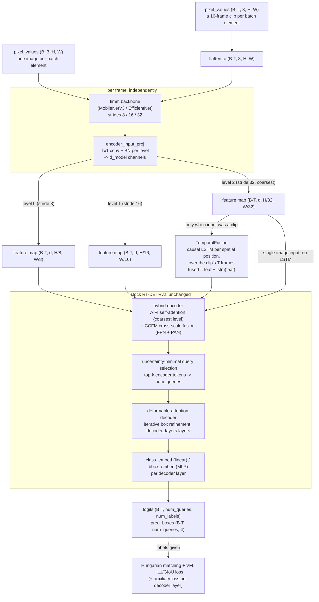

# Boxing punch detection


*Training clip from `task_kam4_gh099681`: the yellow box marks a "Jab fallido" (left-hand miss).*

## Dataset: Olympic Boxing Punch Classification Video Dataset

Raw data lives in `data/raw/punch/`. Each of the 29 folders is one recording session:

```
data/raw/punch/
└── task_kam{2|4}_gh{NNNNNN}/
    ├── annotations.json      # CVAT export (video 1.1 JSON)
    └── data/GH{NNNNNN}.mp4   # source video
```

- `kam2` and `kam4` are the two camera positions. There are 17 `kam2` tasks and 12 `kam4` tasks.
- Videos are 1920×1080, 50 fps, about 3,186 frames (~64 s) per file.

### Annotation format

Each `annotations.json` is a single-element JSON list. The element has four keys:

| key       | contents                                   |
|-----------|--------------------------------------------|
| `version` | CVAT export version (18 in the sample)     |
| `tags`    | always empty                               |
| `shapes`  | always empty (no frame-level shapes)       |
| `tracks`  | list of punch events, one per track        |

Each **track** is one punch event:

```json
{
  "frame": 653,            // first frame of the track
  "group": 0,
  "source": "manual",
  "label": "Chybienie lewą ręką",
  "attributes": [],
  "shapes": [
    {
      "type": "rectangle",
      "points": [x1, y1, x2, y2],   // pixel coordinates, top-left and bottom-right
      "frame": 653,
      "occluded": false,
      "outside": false,              // true = the box disappears on this frame
      "z_order": 0,
      "attributes": []
    }
  ]
}
```

- Shapes are **keyframes**, not one per frame. In the sample, a track spans about 5 keyframes. Interpolate between them to get the box on any frame.
- `outside: true` marks the last frame of the track.
- Boxes are axis-aligned rectangles around the **boxer's** fist/head/body, drawn by hand (`source: "manual"`). No track has attributes.

### Labels

The raw labels are in Polish. There are 8 classes: a target or outcome (head, body, block, miss) combined with a hand (left or right). `preprocess.py` translates each one to a Spanish boxing term and assigns a fixed class id:

| id | raw label (Polish)       | English               | processed name (Spanish) | count |
|---:|--------------------------|-----------------------|--------------------------|------:|
|  0 | `Głowa lewą ręką`        | head, left hand       | `Jab a la cabeza`        | 1,683 |
|  1 | `Głowa prawą ręką`       | head, right hand      | `Cruzado a la cabeza`    |   833 |
|  2 | `Chybienie lewą ręką`    | miss, left hand       | `Jab fallido`            |   734 |
|  3 | `Chybienie prawą ręką`   | miss, right hand      | `Cruzado fallido`        |   449 |
|  4 | `Blok lewą ręką`         | block, left hand      | `Bloqueo de jab`         |   360 |
|  5 | `Blok prawą ręką`        | block, right hand     | `Bloqueo de cruzado`     |   178 |
|  6 | `Korpus lewą ręką`       | body, left hand       | `Jab al cuerpo`          |   193 |
|  7 | `Korpus prawą ręką`      | body, right hand      | `Cruzado al cuerpo`      |   179 |

Counts are across all 29 files. The total is 4,609 tracks and 22,274 keyframe boxes.

**The jab/cross names are an assumption.** The annotations record the hand and the target, not the punch type. Left hand is mapped to *jab* and right hand to *cross* (`cruzado`), which holds for an orthodox (right-handed) boxer. If a boxer is southpaw the mapping is reversed, and hooks and uppercuts cannot be told apart in this data. The class ids come from the order of `RAW_LABELS` in `src/boxing/preprocess.py`, and the Spanish names from `LABELS` in the same file.

Notes:
- Left/right are encoded in the label. Use the label, not the box position, to decide the hand.
- The classes are imbalanced. Head punches are the largest group. Body punches are the smallest.
- Each label combines a **target** (head, body, or block/miss) with a **hand** (left or right). If the task is "which punch was thrown", you may want to merge the hand or the target.

### Dataset stats

- 29 tasks, 4,609 tracks, 22,274 keyframe boxes.
- Tracks per file vary a lot (50 to 162 in the samples checked).
- Only the `rectangle` shape type is used.

## Processed dataset

`src/boxing/preprocess.py` turns the raw CVAT data into **clips**: every training example is a sequence of 16 consecutive frames with a detection target (boxes and a class per box) on every frame.

```
uv run python -m boxing.preprocess data/raw/punch data/processed/punch-seq
uv run python -m boxing.preprocess data/raw/punch data/processed/punch-seq-test --test   # quick check
```

| option           | default | meaning                                                  |
|------------------|--------:|----------------------------------------------------------|
| `--max-size`     |     640 | resize so the longest image side is this many pixels     |
| `--val-fraction` |     0.2 | fraction of tasks held out for validation                |
| `--seed`         |       0 | seed for the train/val split                             |
| `--test`         |     off | small end-to-end run: 3 tasks, first 5 clips of each     |

The clip length is `SEQ_LEN = 16` in `preprocess.py` (0.32 s at 50 fps). Punch tracks last 4 frames at the median, 12 at the 99th percentile and 19 at most, so 16 frames hold almost every punch plus context on both sides.

### Output layout

```
data/processed/punch-seq/
├── labels.json                 # class names, ids, and seq_len
├── train.jsonl                 # one JSON record per clip
├── val.jsonl
└── images/
    └── task_kam2_gh078416/
        └── 000653.jpg          # frame number, zero-padded to 6 digits
```

Clips that overlap in time share the same JPEG files.

### What the script does

1. **Interpolate.** For each track, boxes are linearly interpolated between keyframes, so every frame from the first keyframe up to (not including) the `outside: true` keyframe gets a box.
2. **Cut clips.** Each track becomes one clip of 16 frames centred on the track: the start is `(first + last) // 2 - 8`, shifted to stay inside the video. A track longer than 16 frames keeps its centre 16 frames. Tracks annotated past the end of the video are dropped and counted in the summary line.
3. **Label every frame.** Each frame of a clip lists the boxes of **all** punches visible on it, not only the clip's own track, so overlapping punches stay labelled. Context frames with no punch get empty lists.
4. **Extract frames.** Only frames inside some clip are decoded from the MP4 and saved as JPEG (quality 95).
5. **Resize.** Images are scaled so the longest side is `--max-size` (never upscaled). 1920×1080 becomes 640×360.
6. **Normalise boxes.** Pixel `(x1, y1, x2, y2)` becomes `(cx, cy, w, h)` in `[0, 1]`, relative to the source image size. Boxes are clipped to the image, and degenerate boxes are dropped. Because the values are relative, the resize does not change them.
7. **Map labels.** Each raw Polish label becomes the class id from the table above. An unknown label raises an error.
8. **Split by task.** Whole recording sessions go to either train or val, never both, so clips from one video cannot leak across splits. The split is seeded and reproducible.

### `train.jsonl` / `val.jsonl`

One JSON object per line, one line per clip (`frames` shortened here; it always has 16 entries):

```json
{
  "task": "task_kam2_gh078416",
  "track": 0,
  "label": 2,
  "start": 647,
  "width": 640,
  "height": 360,
  "frames": [
    {"image": "images/task_kam2_gh078416/000647.jpg", "class_labels": [], "boxes": []},
    {"image": "images/task_kam2_gh078416/000653.jpg", "class_labels": [2], "boxes": [[0.49, 0.50, 0.20, 0.18]]}
  ]
}
```

| field            | meaning                                                                        |
|------------------|--------------------------------------------------------------------------------|
| `task`           | recording session the clip comes from                                          |
| `track`          | index of the clip's punch in that task's `annotations.json` `tracks` list      |
| `label`          | class id of that punch (metadata; training uses the per-frame targets)         |
| `start`          | frame number of the first frame                                                |
| `width`/`height` | size of the saved JPEGs in pixels                                              |
| `frames`         | the 16 frames in order, each with `image`, `class_labels` and `boxes`          |
| `frames[].image` | path relative to the processed dataset folder                                  |
| `frames[].class_labels` | class id for each box on that frame (see the label table)               |
| `frames[].boxes` | `[cx, cy, w, h]` per box, normalised to `[0, 1]`; same order as `class_labels` |

Each frame's `{"class_labels", "boxes"}` is the target format that `RTDetrV2ForObjectDetection` takes as `labels`.

### `labels.json`

```json
{
  "names": ["Jab a la cabeza", "Cruzado a la cabeza", "..."],
  "id2label": {"0": "Jab a la cabeza", "1": "Cruzado a la cabeza", "...": "..."},
  "label2id": {"Jab a la cabeza": 0, "Cruzado a la cabeza": 1, "...": "..."},
  "seq_len": 16
}
```

`id2label` keys are strings because JSON requires it. `load_id2label` (`src/boxing/dataset.py`) converts them to integers.

Pass `id2label` to `build_model(..., id2label=...)` so saved models carry the class names.

### Loading clips

`src/boxing/dataset.py` loads the clips for PyTorch. `BoxingDetector` takes single images, so `flatten_clips` turns a batch of clips into a batch of frames:

```python
from pathlib import Path
from torch.utils.data import DataLoader
from boxing.dataset import PunchSequenceDataset, collate_clips, flatten_clips

ds = PunchSequenceDataset(Path("data/processed/punch-seq"), "train")   # x: (16, 3, 640, 640)
dl = DataLoader(ds, batch_size=2, shuffle=True, collate_fn=collate_clips)
for x, targets in dl:                       # x: (B, 16, 3, 640, 640)
    x, targets = flatten_clips(x, targets)   # x: (B*16, 3, 640, 640), 16*B target dicts
    loss = model(pixel_values=x, labels=targets).loss
```

A batch of `B` clips is `16 × B` images, so use a much smaller batch size than for single frames.

## Model

`BoxingDetector` (`src/boxing/model.py`) is RT-DETRv2 (Hugging Face `RTDetrV2ForObjectDetection`) with a `timm` MobileNet/EfficientNet backbone, plus a causal LSTM that fuses a clip's frames on the coarsest feature map before the (otherwise unmodified) hybrid encoder and decoder:



A single image (`pixel_values.dim() == 4`) takes the plain, untouched RT-DETRv2 path — no backbone/encoder call is duplicated and the LSTM is never invoked. A clip (`dim() == 5`) is flattened to `B·T` images for the backbone and heads, but the coarsest level's `(B·T, d, h, w)` feature map is reshaped to `(B·h·w, T, d)` so the LSTM sees one sequence of length `T` per spatial position, then reshaped back before being added as a residual. `labels` for a clip is `list[list[dict]]` (length `B`, each length `T`, one target dict per frame — the same `{"class_labels", "boxes"}` shape as the single-image case), flattened in the same `B·T` order as the frames.

Build with `temporal=False` to skip `TemporalFusion` and treat a clip's frames independently (equivalent to `flatten_clips`, but without a second code path).

## Run in Colab

[](https://colab.research.google.com/github/jmanuelc87/boxing/blob/main/notebooks/train.ipynb)

1. Open the badge above, then **Runtime → Change runtime type → GPU**.
2. Create a `.env` file from `.env.example` and upload it to `MyDrive/boxing/.env` in Google Drive. It needs `KAGGLE_API_TOKEN` (or `KAGGLE_USERNAME` and `KAGGLE_KEY`) and `WANDB_API_KEY`.
3. Run the notebook from top to bottom. The first cell mounts Drive and clones this repo to `/content/boxing`. The download and preprocessing cells fetch the dataset and build `data/processed/punch`.

Data and checkpoints are written to the Colab VM and are lost when the runtime resets. Only `.env` is read from Drive.
